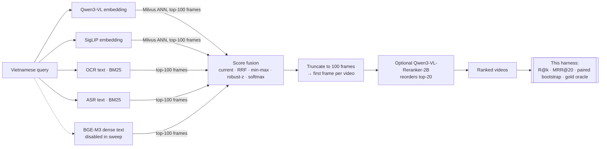

# vecna-eval-harness

An offline evaluation harness for **multi-provider video retrieval**, extracted from my evaluation work on **VECNA**. VECNA is a team system for Vietnamese news-video search at AI Challenge HCMC 2026, where the team received an Honors Award. The main system is at [JimmyK300/Vecna](https://github.com/JimmyK300/Vecna). This repository contains the measurement side: how retrieval changes were scored, compared and accepted or rejected.

> **No contest data is included.** The organizers' videos, keyframes, query text and ground truth are not redistributable. Results are reported as aggregate numbers and query IDs, with a source file for every number. The harness runs on a bundled **synthetic** benchmark or on your own data.

## The problem

- **Corpus:** 873 Vietnamese news and documentary videos (130.7 hours).
- **Queries:** natural-language Vietnamese descriptions of a moment. Example task types are *find this scene* (KIS), *find this ordered sequence of events* (TRAKE) and *answer a question about a scene* (QA).
- **Goal:** return the right video, and ideally the right frames, in the top 20.
- **Benchmark:** 115 queries from rounds P0 to P3. 113 are scoreable, because 2 are excluded.

No single signal is enough. Some queries describe what is on screen, some can only be answered from on-screen text or speech, and many combine several constraints in one long sentence.

## Architecture



The experiment log also covers other embedders (WeMM-9B, CLIP), a Gemini-written semantic index, and clause decomposition. All provider lists are **saved once and replayed**, so each fusion or reranking rule is compared on identical inputs. Differences then come from the rule, not from retrieval noise.

## Results

The full write-ups, with per-query IDs and sources, are in [`results/`](results/).

**1. Fusion sweep.** The same provider lists were fused five ways. Counts are out of 113 ([details](results/fusion_sweep_113.md)):

| Fusion rule | R@1 | R@20 | MRR@20 |
|---|---:|---:|---:|
| **Current (nested max scaling)** | **49** | **87** | **0.529989** |
| Softmax, T = 1 | 16 | 86 | 0.304353 |
| RRF, k = 60 | 36 | 85 | 0.433591 |
| Min–max | 36 | 84 | 0.429601 |
| Robust-z | 36 | 81 | 0.411475 |
| *Qwen3-VL alone* | *47* | *84* | *0.507495* |

**2. Reranker audit.** Qwen3-VL-Reranker-2B raised R@20 from **68 to 76/113**, but R@1 went from **41 to 40**, at **28.219 s per query** ([details](results/reranker_audit_113.md)).

**3. Oracle ceiling.** Picking the best of 153 saved (run, arm) pairs for each query *with the answer key* reaches **108/113** videos in the top 20 and **87/113** with complete evidence. The gap between 87 and 108 is routing headroom, not an achievable score ([details](results/oracle_saved_runs_113.md)).

**4. Clause decomposition was rejected.** Searching each clause separately and RRF-fusing the lists dropped R@20 from **13/19 to 9/19** ([details](results/clause_decomposition_19.md)).

## What failed and why

- **Standard normalizations lost to the existing fusion.** Every alternative lost MRR with a 95% interval entirely below zero, and none won R@20. Softmax nearly kept R@20 (86) but fell to 16 at R@1. The regressions happen after retrieval, since the provider lists are identical, but the evidence does not pin down a single cause. The alternatives also use different effective weights, so this is a frozen-configuration comparison. *Lesson:* "use RRF" is not a free default. Measure it on frozen lists.
- **The reranker helped recall but not the top result.** It rescued 9 queries at R@20 and lost 1, but R@1 and R@10 did not improve, and each call cost about 28 s on our GPU. The decision was to keep it operator-triggered instead of always on.
- **Splitting queries into clauses backfired.** It rescued the case it was designed for, where a key phrase was buried in a long query. But it regressed 12 of 19 queries, because generic clauses outvoted the one video matching the whole conjunction. Some misses were caused by the visual detail being absent from the index text, which no query rewrite can fix.
- **Most remaining misses are about selection, not models.** Some saved arm finds the right video for 108/113 queries, while the best single method finds 87. A router could close part of that gap, but no routing rule we tested showed an advantage *without* the answer key.

## Run it

Requires Python ≥ 3.10. There are no third-party dependencies (`pytest` is optional).

```bash
python -m unittest discover -s tests -v          # 15 tests, < 1 s
python -m vecna_eval --rankings data/synthetic/provider_rankings.jsonl \
                     --truth data/synthetic/ground_truth.jsonl --out runs/synthetic
```

This prints the arm table and writes `runs/synthetic/result.json`, which holds per-arm metrics, R@20 rescues and regressions against the control, paired-bootstrap intervals, the oracle and per-query first-correct ranks.

**On your own data**, write one JSON line per query in each of two files:

```jsonc
// rankings.jsonl: each provider's list, best first; frame_id = "<video>#<frame>"
{"query_id": "q1", "providers": {"qwen": [{"frame_id": "news_12#004520", "score": 0.41}, ...],
                                  "siglip": [...], "ocr_sparse": [...], "asr_sparse": [...]}}
// truth.jsonl
{"query_id": "q1", "accepted_videos": ["news_12"], "excluded": false}
```

Provider names are configurable. Pass `--config cfg.json` to set `visual_providers`, `ocr_weight`/`asr_weight`, the dense/sparse `*_alpha` and the frame/video budgets. The scoring contract is described in [`docs/PROTOCOL.md`](docs/PROTOCOL.md).

## Limitations

- **Small, reused benchmark.** 113 queries were used for every decision, so the intervals are descriptive, not confirmatory. P3 truth is provisional, made by the team rather than the organizers.
- **The numbers cannot be reproduced from this repo.** They need the contest corpus. This repo holds re-implemented scoring and fusion logic that matches the original rules, plus the cited sources.
- **The synthetic data is only for testing.** Its arm ranking says nothing about real video retrieval.
- **Video-level metric.** Distinct-video R@k does not check that the answer-bearing *moment* was retrieved. The oracle's "complete evidence" column shows how much stricter that is.
- **The `legacy/` scripts are corpus-coupled** and will not run without the original data layout. They are included to show how indexing and validation were done.

## Repository layout

```
vecna_eval/     harness: io, fusion arms, scoring, oracle, bootstrap, CLI
data/synthetic/ generator + generated synthetic benchmark (fake IDs only)
tests/          smoke test (end-to-end) + fusion/scoring unit tests
results/        the four reported experiments, with sources
docs/           scoring and experiment protocol
legacy/         original scripts (path-scrubbed, data removed), not runnable standalone
```

## License

The code is under the [MIT license](LICENSE). This license covers the code in this repository only. It grants no rights to AI Challenge HCMC data, which is not included.
